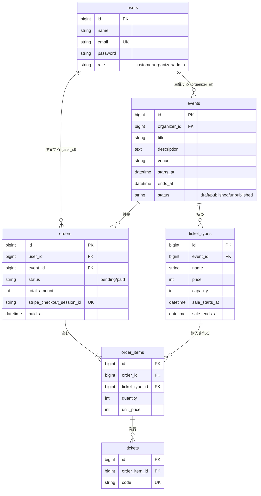

# データベース設計

## ER 図



## カラム定義

### users（既存のテーブルにカラムを追加）

| カラム | 型 | 制約 | 説明 |
|-|-|-|-|
| role | string(20) | NOT NULL, default `customer` | `customer` / `organizer` / `admin`。PHP の Enum `UserRole` で扱う |

その他のカラム（name、email など）は既存のマイグレーションのまま使う。

### events

| カラム | 型 | 制約 | 説明 |
|-|-|-|-|
| id | bigint | PK | |
| organizer_id | bigint | FK → users.id, **restrict** | 主催者 |
| title | string(100) | NOT NULL | イベント名 |
| description | text | NOT NULL | 説明 |
| venue | string(255) | NOT NULL | 会場 |
| starts_at | datetime | NOT NULL | 開催日時（Asia/Tokyo） |
| ends_at | datetime | NOT NULL | 終了日時。`starts_at` より後かどうかはバリデーションで確認する |
| status | string(20) | NOT NULL, default `draft` | `draft`（下書き）/ `published`（公開）/ `unpublished`（管理者による非公開）。Enum `EventStatus` |
| created_at / updated_at | timestamp | | |

インデックス：`(status, starts_at)`。公開中のイベントを開催日が近い順に並べる一覧（C3）で使う。

### ticket_types

| カラム | 型 | 制約 | 説明 |
|-|-|-|-|
| id | bigint | PK | |
| event_id | bigint | FK → events.id, **cascade** | 所属するイベント |
| name | string(50) | NOT NULL | 券種名（一般、学生など） |
| price | unsigned int | NOT NULL | 価格（円）。0 は無料券 |
| capacity | unsigned int | NOT NULL | 定員 |
| sale_starts_at | datetime | NOT NULL | 販売開始 |
| sale_ends_at | datetime | NOT NULL | 販売終了。`sale_starts_at` より後かどうかはバリデーションで確認する |
| created_at / updated_at | timestamp | | |

### orders

| カラム | 型 | 制約 | 説明 |
|-|-|-|-|
| id | bigint | PK | |
| user_id | bigint | FK → users.id, **restrict** | 注文者 |
| event_id | bigint | FK → events.id, **restrict** | 対象のイベント。売上集計（C16）を簡単にするために持つ |
| status | string(20) | NOT NULL, default `pending` | `pending`（支払い待ち）/ `paid`（支払い済み）。Enum `OrderStatus` |
| total_amount | unsigned int | NOT NULL | 合計金額（円） |
| stripe_checkout_session_id | string(255) | NULL, UNIQUE | Checkout Session の ID。作成前と 0 円の注文では NULL |
| paid_at | datetime | NULL | 支払いが確定した日時 |
| created_at / updated_at | timestamp | | |

インデックス：`user_id`（マイページ）、`(event_id, status)`（売上集計）。

### order_items

| カラム | 型 | 制約 | 説明 |
|-|-|-|-|
| id | bigint | PK | |
| order_id | bigint | FK → orders.id, **cascade** | 所属する注文 |
| ticket_type_id | bigint | FK → ticket_types.id, **restrict** | 購入した券種 |
| quantity | unsigned smallint | NOT NULL | 枚数（1 以上） |
| unit_price | unsigned int | NOT NULL | 注文時点の単価（円）。小計は `quantity × unit_price` で計算する |
| created_at / updated_at | timestamp | | |

### tickets

| カラム | 型 | 制約 | 説明 |
|-|-|-|-|
| id | bigint | PK | |
| order_item_id | bigint | FK → order_items.id, **cascade** | どの明細から発行されたか |
| code | string(26) | NOT NULL, UNIQUE | チケット固有のコード（ULID）。推測されにくく、拡張 E1 の QR にもそのまま使える |
| created_at / updated_at | timestamp | | |

## 外部キーの削除時の動き

| 外部キー | 動き | 理由 |
|-|-|-|
| events.organizer_id | restrict | 主催者を消すとイベントと売上の記録が消えてしまうため |
| orders.user_id | restrict | 注文は取引の記録なので残す |
| orders.event_id | restrict | 注文があるイベントは削除できないようにする（T5） |
| ticket_types.event_id | cascade | 注文のないイベントを削除したときは、券種も一緒に消す |
| order_items.ticket_type_id | restrict | 注文済みの券種は削除できないようにする |
| order_items.order_id | cascade | 明細は注文の一部なので一緒に消す |
| tickets.order_item_id | cascade | チケットは明細の一部なので一緒に消す |

T5（支払い済みの注文があるイベントは削除できない）は、アプリのポリシーで先にチェックしてエラーを表示する。DB の restrict は、そのチェックをすり抜けたときの最後の防御。

## 残り枚数の計算方法

残り枚数はカラムに持たず、券種ごとに毎回計算する。

```
残り枚数 = ticket_types.capacity − 確保済みの枚数
```

確保済みの枚数は、次の条件に合う `order_items.quantity` の合計。

- `order_items.ticket_type_id` が対象の券種
- 注文（orders）が次のどちらか
  - `status = paid`
  - `status = pending` かつ `created_at` が 35 分以内（支払い中の枠を確保しておく）

SQL のイメージ：

```sql
SELECT tt.capacity - COALESCE(SUM(oi.quantity), 0) AS remaining
FROM ticket_types tt
LEFT JOIN order_items oi ON oi.ticket_type_id = tt.id
  AND EXISTS (
    SELECT 1 FROM orders o
    WHERE o.id = oi.order_id
      AND (o.status = 'paid'
           OR (o.status = 'pending' AND o.created_at >= NOW() - INTERVAL 35 MINUTE))
  )
WHERE tt.id = ?
GROUP BY tt.id, tt.capacity;
```

### カラムに持たない理由

同じ事実を2か所に持つと、片方だけ更新されたときにずれるため。

- 35 分経った pending は、DB に何も起きないまま枠を手放す（カラムを更新する契機がない）
- 購入・支払い確定・定員変更・注文削除・返金（E3）のどれかで更新を忘れるとずれる
- 途中で失敗すると片方だけ反映される

### 注意点

- 計算にしても、同時購入で定員を超えて売れる問題は残る。購入時はトランザクション内で券種の行をロック（`lockForUpdate`）してから残り枚数を計算する（拡張 E2）
- 35 分の値は定数 `Order::HOLD_MINUTES` にまとめ、「枠を押さえている注文」の条件はスコープ `Order::holdingSeats()` に置く
- Stripe Checkout Session の有効期限（`expires_at`）は 30 分（`CheckoutService::EXPIRES_MINUTES`）。枠を押さえる時間（35 分）をそれより長くして、枠を手放したあとに支払われないようにしている
- 実装は `TicketType::remaining()` と、一覧用に `withSum` で集計するスコープ `TicketType::withHeldQuantity()`

## 設計判断

- **残り枚数は保存しない**：詳細は「残り枚数の計算方法」を参照。初期データにある「35 分以上前の pending」はこの前提。
- **金額は円の整数**（unsigned int）：Stripe の JPY に小数がないため。
- **status は string ＋ PHP Enum**：MySQL の enum 型は値を増やすときに変更が面倒なので避ける（`cancelled` と `refunded` もマイグレーションなしで足せた）。
- **このあと拡張で足すカラム**：画像の `events.image_path`（E14）と、受付済みかどうかの `tickets.checked_in_at`（E1）。コアには入れていない。
- **券種名の保存**：注文時点の券種名は明細に保存していない。あとで券種名を変えると、過去の注文の表示も変わる。気になる場合は `order_items.ticket_type_name` を追加する。
