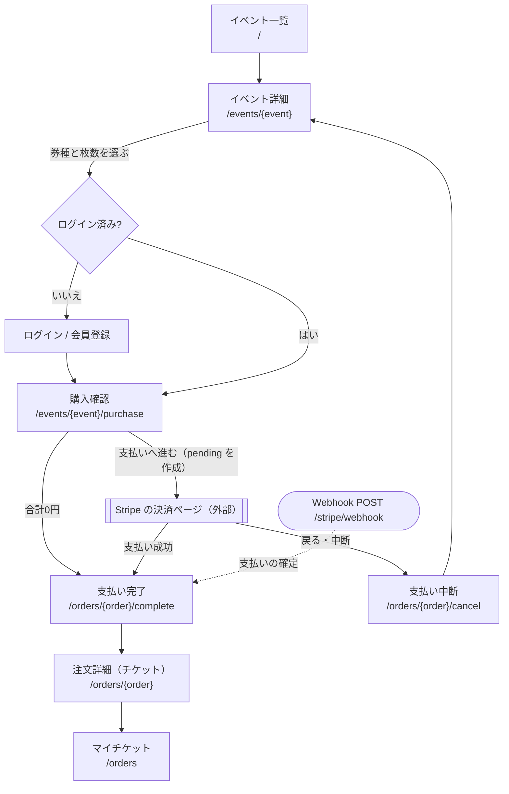

# 画面一覧

## 段階1：予約と販売の土台

| 画面名 | URL | ログインが必要か | 使えるロール | 表示するもの・できること |
|-|-|-|-|-|
| イベント一覧（トップ） | `/` | 不要 | 誰でも | 公開中のイベントを開催日が近い順にカードで表示（開催済みは除く、12件ずつ）。最安値、詳細へのリンク（C3） |
| イベント詳細 | `/events/{event}` | 不要（購入時は必要） | 誰でも／購入はログインユーザー | 日時・会場・主催者名・説明、券種ごとの価格・残り枚数・販売期間・販売状態。券種と枚数（1〜10枚）を選んで購入確認へ（C4, C8）。下書き・非公開は所有者と管理者のみ閲覧可、他は 404 |
| 購入確認 | `/events/{event}/purchase` | 必要 | ログインユーザー | 選んだ券種・枚数・単価・小計・合計を DB の価格で表示。確定で残り枚数と販売期間を再チェックし、注文（pending）を作る（C8, C9） |
| 会員登録 | `/register` | 不要 | ゲスト | 名前・メール・パスワード、「参加者 / 主催者」の選択（C1） |
| ログイン | `/login` | 不要 | ゲスト | ログイン、パスワードリセットへのリンク（C1） |
| パスワードリセット | `/forgot-password`、`/reset-password/{token}` | 不要 | ゲスト | 再設定メールの送信、新パスワードの設定（C1） |
| 主催者メニュー | `/organizer/events` | 必要 | 主催者 | 自分のイベント一覧（状態・開催日）、新規登録・編集へのリンク（C15） |
| イベント登録 | `/organizer/events/create` | 必要 | 主催者 | タイトル・説明・会場・開始と終了の日時を入力し、下書きで保存（C5） |
| イベント編集 | `/organizer/events/{event}/edit` | 必要 | 主催者（自分のイベントのみ） | イベント情報の編集、券種（価格・定員・販売期間）の追加・編集・削除、下書き/公開の切り替え（券種1件以上が条件）、イベント削除（C5〜C7）。他人のイベントは 403（C2） |

## 段階2：決済・メール・売上

| 画面名 | URL | ログインが必要か | 使えるロール | 表示するもの・できること |
|-|-|-|-|-|
| 支払い完了 | `/orders/{order}/complete` | 必要 | 注文した本人 | 確定していれば「購入が完了しました」と注文詳細へのリンク。未確定なら「確認中」として数秒ごとに再確認（C13） |
| 支払い中断 | `/orders/{order}/cancel` | 必要 | 注文した本人 | 決済ページを失効させて注文をキャンセルし、押さえていた枠を戻す。イベント詳細へ戻るリンク（C13） |
| マイチケット（注文一覧） | `/orders` | 必要 | ログインユーザー全員 | 自分の注文（注文日・イベント名・開催日・枚数・合計・状態）の一覧（C14） |
| 注文詳細 | `/orders/{order}` | 必要 | 本人・そのイベントの主催者・管理者 | 券種・枚数・単価・合計、発行されたチケット（券種名とコード）（C14）。他人は 403 |
| 注文一覧・売上 | `/organizer/events/{event}/orders` | 必要 | 主催者（自分のイベントのみ）・管理者 | 支払い済みの注文一覧、券種ごとの販売枚数と売上、全体の売上合計（C16） |

## 購入までの画面遷移

## 補足

- 画面ではないもの：Stripe Checkout の決済ページ（Stripe 側）、Webhook `POST /stripe/webhook`（C11）、購入完了メール（C12）
- `/dashboard` はロールで振り分ける：管理者はイベント一覧 `/`（管理者の画面 E15 ができるまで）、主催者は `/organizer/events`、参加者は `/orders`
- 公開側の画面は未ログインでも使えるヘッダー型のレイアウト、ログイン後の画面はサイドバー型のレイアウト
