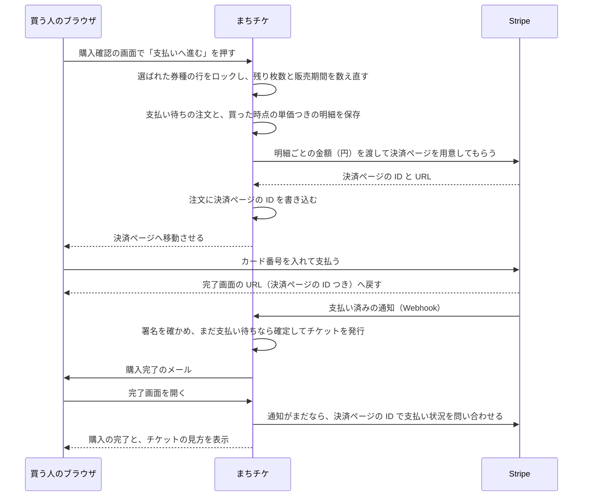

# まちチケ 決済とメールの流れ、テスト、初期データ

## 買ってからチケットが届くまで

 

## Stripe とのつなぎ方

- 使うのは `stripe/stripe-php` だけ。Cashier は入れない（1回きりの支払いしか扱わず、顧客や定期課金の仕組みが要らないため）
- Stripe を呼び出すのは `app/Services/CheckoutService.php` の中だけにする。テストではこのクラスを偽物に差し替える
- 商品は Stripe 側に登録しておかず、決済ページを作るたびに明細から金額を渡す（`mode = payment`、`price_data` の `currency` は `jpy`、`unit_amount` は明細の `unit_price`、品名は「イベント名 券種名」）
- どの注文の支払いかは `metadata.order_id` で分かるようにしておく
- 支払い後の戻り先は `/orders/{order}/complete`（決済ページの ID をクエリに付ける）、やめたときの戻り先は `/orders/{order}/cancel`
- 通知の受け口は `POST /stripe/webhook`。CSRF の対象から外し、`Webhook::constructEvent()` で署名を確かめる。合わなければ 400
- 今受け取る通知は `checkout.session.completed` だけ。返金を入れるときに `charge.refunded` を足す
- 支払いの確定は `OrderService::markAsPaid()` だけで行う。`status` がまだ pending の行だけを更新する UPDATE にして、通知と完了画面が重なっても一度しか確定しない。メールもここから、確定できたときにだけ送る
- 合計が0円の注文は決済ページを使わず、同じ `markAsPaid()` で確定する
- 決済ページから戻ってやめたときは、先に決済ページを失効させてから注文を cancelled にする（失効させないと、ブラウザの「進む」で戻って払えてしまう）

### 設定する値（`.env`）

| 名前 | 何の値か | 手元で動かすとき | 本番 |
|-|-|-|-|
| `STRIPE_KEY` | ブラウザに出してよい公開用の鍵 | `pk_test_` で始まるテスト用 | `pk_live_` で始まる本番用 |
| `STRIPE_SECRET` | サーバーだけが持つ秘密の鍵 | `sk_test_` で始まるテスト用 | `sk_live_` で始まる本番用 |
| `STRIPE_WEBHOOK_SECRET` | 通知の署名を確かめる鍵（`whsec_`） | `stripe listen` を動かすと表示される | Stripe のダッシュボードで受け口を登録すると発行される |

### 手元で通知を受けるには

- Stripe CLI で `stripe listen --forward-to localhost/stripe/webhook` を動かすと、テストの通知が手元に届く
- CLI が無くても、完了画面からの問い合わせで支払いは確定できる。通知の経路は本番に出してから確かめる

 

## メール

| 種類 | 送るとき | 相手 | 中身 |
|-|-|-|-|
| 購入完了 | `markAsPaid()` で注文を確定できたとき（1回だけ） | 注文した人 | イベント名・日時・会場、券種ごとの単価・枚数・小計、合計、注文詳細の URL |

- Mailable を1つ、Markdown のテンプレートで作る
- 手元では Mailpit（`http://localhost:8025`）で受け取って中身を見る
- 本番は無料枠のあるメール API を1つに決め（Resend など）、`.env` の `MAIL_MAILER` と鍵を差し替えるだけで切り替える
- 送信はその場で行い、キューは使わない（お知らせメールを足すときに入れる）

 

## テスト一覧（C18）

| # | 見るところ | 期待する動き | テストのファイル |
|:-:|-|-|-|
| T1 | トップの一覧 | 公開中で開催前のものだけが出る。下書き・非公開・終わったものは出ない | `Events/EventListTest.php` |
| T2 | 下書きの詳細 | 持ち主と管理者は開ける。それ以外の人には 404 | `Events/EventShowTest.php` |
| T3 | イベントの登録 | 主催者は登録できる。参加者には 403 | `Organizer/EventManagementTest.php` |
| T4 | イベントの編集 | 持ち主は保存できる。ほかの主催者には 403 | `Organizer/EventManagementTest.php` |
| T5 | イベントの削除 | 注文が付いていると消せない（支払い前の注文も含む） | `Organizer/EventManagementTest.php` |
| T6 | 注文の作成 | 支払い待ちの注文ができ、明細の単価と合計が DB の価格どおり。Stripe は偽物 | 工程5で追加 |
| T7 | 残りを超える注文 | 残り枚数より多いとエラーになり、注文はできない | 工程5で追加 |
| T8 | 販売期間の外 | 売り出し前・締め切り後はエラーになる | 工程5で追加 |
| T9 | 正しい通知 | 署名が合う `checkout.session.completed` で注文が paid になり、枚数ぶんのチケットとメール1通が出る | 工程8で追加 |
| T10 | 署名が合わない通知 | 400 を返し、注文はそのまま | 工程8で追加 |
| T11 | 同じ通知が2回 | チケットもメールも増えない | 工程8で追加 |
| T12 | 注文の詳細 | 本人・そのイベントの主催者・管理者は見られる。ほかの人には 403 | 工程9で追加 |
| T13 | 管理者による非公開 | 管理者は unpublished にできる。主催者は他人のイベントを変えられない | 管理画面と一緒に追加 |

外部サービスの扱い: Stripe とのやりとりは `CheckoutService` に閉じ込め、テストではそのクラスだけを偽物にする。

 

## 初期データ（シーダー）

| 種類 | 数 | 中身 |
|-|:-:|-|
| 管理者 | 1人 | ログインは `admin@example.com` |
| 主催者 | 2人 | `organizer1@example.com` と `organizer2@example.com` |
| 参加者 | 3人 | `customer1@example.com`、`customer2@example.com`、`customer3@example.com` |
| イベント | 6件 | 公開中4件（そのうち1件は開催済み）、下書き1件、非公開1件。題名は八幡平らしい体験にする（山歩き、温泉の蒸気を使う料理、雪の上での運動など） |
| 券種 | 1イベントに1〜3種 | 3,000円の一般、1,500円の学生、0円の無料券などを組み合わせる。定員は5〜30 |
| 注文 | 数件 | 支払い済みのものと、作成から35分より前の支払い待ち（枠を手放したもの）を混ぜる |

- 全員のパスワードは `password`。本番には管理者の1人だけを入れる
- 写真（E14 のあと）は `database/seeders/images/` に6枚置き、シーダーで `public` ディスクへ写す
